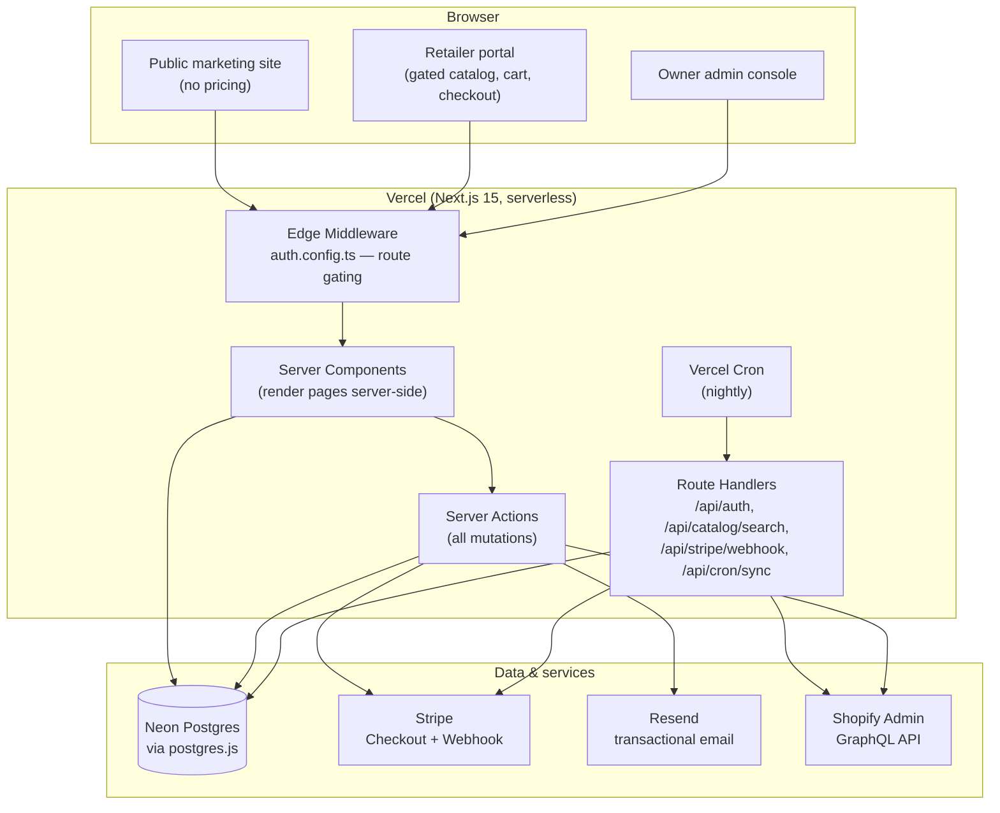
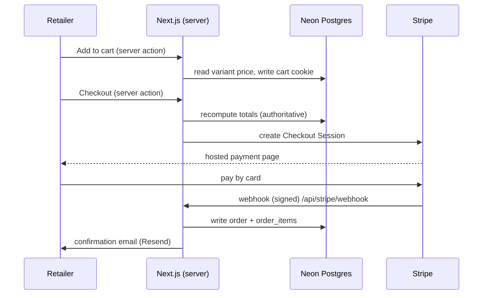
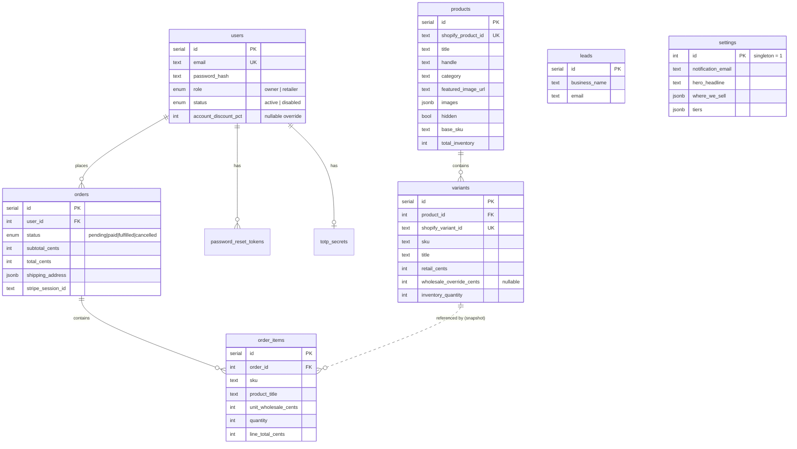

# Majestic Ally Wholesale — Technical Documentation

*Architecture & engineering reference. Last updated Oct 2026.*

A B2B wholesale ordering portal for Majestic Ally (Amay International LLC). Public marketing site + a login-gated retailer catalog with wholesale pricing, cart and checkout, and an owner admin console. Live on Vercel, backed by Neon Postgres.

---

## 1. Tech stack

| Layer | Technology | Version | Why it's here |
|---|---|---|---|
| Framework | **Next.js** (App Router) | 15.5.25 | Server Components + Server Actions let pricing stay 100% server-side; one framework for site, API, and admin. |
| UI runtime | **React** | 19.0.0 | Required by Next 15; Server + Client Components. |
| Language | **TypeScript** | 5.7.3 | Type safety end-to-end (DB rows → UI props). |
| Auth | **Auth.js / NextAuth** | 5.0.0-beta.25 | Credentials provider, JWT sessions, edge-safe middleware. |
| Password hashing | **bcryptjs** | 2.4.3 | Salted bcrypt, cost factor 12. |
| ORM | **Drizzle ORM** | 0.38.3 | Typed SQL, lightweight, SQL-first migrations via `drizzle-kit` 0.30. |
| Production DB driver | **postgres** (postgres.js) | 3.4.5 | Connection to Neon over TCP. |
| Local DB | **@electric-sql/pglite** | 0.2.14 | In-process Postgres for zero-setup local dev (no Docker/DB needed). |
| Styling | **Tailwind CSS** | 3.4.17 | Utility CSS; brand tokens in `tailwind.config.ts`. |
| Icons | **lucide-react** | 0.469.0 | Icon set. |
| Payments | **Stripe** | 17.5.0 | Hosted Checkout + webhook (no card data touches the app). |
| Email | **Resend** | 4.0.1 | Transactional email (lead notifications, retailer welcome, password reset). |
| Validation | **Zod** | 3.24.1 | Schema validation on every form / server action input. |
| Catalog source | **Shopify Admin GraphQL API** | API 2026-01 | Product/variant/image/inventory sync. |
| Hosting | **Vercel** | — | Serverless hosting, Cron, env management, Git-push deploys. |
| Database host | **Neon** | — | Serverless Postgres (branch: `production`, region AWS us-east-2). |

Money is stored and computed as **integer cents** everywhere to avoid floating-point errors. All amounts are USD.

---

## 2. System architecture



**Key architectural decisions**

1. **Server-side price gating (the security backbone).** Wholesale prices are never sent to an unauthenticated browser. They are computed on the server in `src/lib/pricing.ts` and only rendered into HTML for logged-in sessions. There is no "hide with CSS/JS" — the data simply isn't in the public payload. Gating is enforced in two layers: edge middleware (coarse route protection) and `requireUser()` / `requireOwner()` inside every protected page and server action (authoritative).

2. **Server Actions for all writes.** Cart changes, checkout, admin CRUD, retailer/order deletion, settings, and sync are Next.js Server Actions — type-safe RPC with no hand-written API layer. Only four things are true HTTP route handlers (below), because they're called by external systems or need raw requests.

3. **Two database backends, one interface.** `src/db/index.ts` returns PGlite locally (no DB to install) and postgres.js against Neon in production, selected by the `DATABASE_URL` env var. A `globalThis` singleton prevents multiple pooled connections across serverless invocations / HMR.

4. **Catalog is a cache of Shopify.** Products/variants/images/inventory are synced from Shopify into Postgres (`src/lib/shopify.ts`). The portal reads from Postgres (fast, no live API calls per request); a nightly Vercel Cron job and an on-demand admin button refresh it.

---

## 3. Request flows

### Public visitor
`/`, `/become-a-retailer` → middleware allows → Server Component renders marketing content from `settings` (editable copy). The retailer-interest form posts to a server action (`submitLead`) that validates with Zod, stores a `leads` row, and emails the owner via Resend. **No pricing anywhere in these responses.**

### Retailer (logged in)
`/catalog`, `/catalog/[handle]`, `/cart`, `/checkout`, `/account` → middleware checks the signed JWT; pages also call `requireUser()`. Catalog and product pages compute each line's wholesale price server-side (flat 40% off MSRP, or a per-account/per-SKU override). Cart lives in an HTTP-only cookie keyed to the session; totals are always recomputed server-side at render and at checkout — the client never submits a price.

### Checkout
`/checkout` → `createCheckoutSession` server action recomputes totals from the DB, creates a **Stripe Checkout Session** (hosted page), and redirects. Stripe handles all card entry. On payment, Stripe calls `/api/stripe/webhook`, which verifies the signature, writes the `orders` + `order_items` rows, and emails a confirmation. The app never sees card numbers.

### Owner (admin)
`/admin/*` → middleware requires `role === "owner"`; every admin page/action also calls `requireOwner()`. Covers dashboard, product edit + per-SKU overrides + search/category filter, retailer create/disable/reset/**delete**, order status + **delete**, leads, editable site settings, and "Refresh from Shopify."

### Nightly sync
Vercel Cron → `GET /api/cron/sync` (guarded by a `CRON_SECRET` bearer token) → pulls the Shopify catalog via GraphQL and upserts products/variants/images/inventory.



---

## 4. Data model

Nine tables. `id` is a serial PK unless noted; money is integer cents; timestamps are `timestamptz`.



Notes:
- **`settings`** is a single editable row (`id = 1`) holding brand copy, the notification email, shipping config, and the pricing-tier table — all editable from Admin → Settings with no deploy.
- **`order_items`** store a *snapshot* of title/SKU/price at purchase time, so historical orders stay correct even if a product later changes or is deleted.
- Deleting a product cascades to its variants; deleting an order cascades to its items; deleting a user cascades to their reset tokens and TOTP secret (orders are removed explicitly first).

---

## 5. Security model

- **Authentication:** Auth.js Credentials provider; passwords bcrypt-hashed (cost 12). Sessions are stateless **JWTs** in an HTTP-only, signed cookie (`AUTH_SECRET`). The config is split: `auth.config.ts` is edge-safe (no DB/bcrypt) for middleware; `auth.ts` runs in Node for the actual credential check.
- **Authorization:** Two roles — `owner` (full admin) and `retailer` (catalog + ordering). No public signup grants access; the owner provisions retailer accounts. The public "Become a retailer" form only creates a *lead*.
- **Price confidentiality:** enforced server-side (Section 2.1). Verified: logged out, `/catalog /cart /checkout /account /admin` all 307-redirect to login, and the search + cron APIs return 401.
- **Input validation:** every form/action input is parsed with Zod before touching the DB.
- **Payments:** Stripe hosted Checkout — no PAN/CVV ever reaches the app; the webhook is signature-verified (`STRIPE_WEBHOOK_SECRET`).
- **Abuse controls:** the public lead form is rate-limited (`src/lib/rate-limit.ts`) and has a honeypot field.
- **Cron protection:** `/api/cron/sync` requires a `CRON_SECRET` bearer token.
- **Secrets:** all live only as Vercel environment variables; none are committed (`.env*` is git-ignored).

---

## 6. Directory structure

```
src/
  app/
    page.tsx                     Public homepage (hero, product lines, story, marketplaces)
    become-a-retailer/           Public lead form + action
    login/ forgot-password/ reset-password/   Auth flows
    catalog/                     Gated catalog (list + [handle] detail)
    cart/ checkout/ account/     Retailer ordering + order history
    admin/                       Owner console
      page.tsx                   Dashboard
      products/                  List, [id] edit, new, per-SKU overrides, search/filter
      retailers/                 Create / disable / reset / delete
      orders/                    Status + delete
      leads/ settings/           Inquiries, editable site config
    api/
      auth/[...nextauth]/        Auth.js handler
      catalog/search/            Typeahead search (gated)
      stripe/webhook/            Stripe event receiver
      cron/sync/                 Nightly Shopify sync (token-guarded)
  auth.ts  auth.config.ts        Auth.js (Node + edge-safe) config
  middleware.ts                  Route gating
  components/                    Header, footer, product card/gallery, hero showcase, etc.
  db/
    schema.ts                    Drizzle schema (9 tables)
    index.ts                     DB connection (PGlite local / postgres.js prod)
  lib/
    pricing.ts                   Wholesale math (single source of truth for money)
    cart.ts  orders.ts           Cart + order logic
    catalog.ts  admin.ts         Read models for portal + admin
    shopify.ts  categorize.ts    Shopify sync + category derivation
    settings.ts  email.ts        Editable settings + Resend wrapper
    auth-helpers.ts  password.ts  tokens.ts  rate-limit.ts  sku.ts  utils.ts
scripts/seed.ts                  Seed owner, demo retailer, settings, products
drizzle/                         SQL migrations
```

---

## 7. External services & environment variables

| Variable | Required? | Purpose |
|---|---|---|
| `DATABASE_URL` | **Yes** | Neon Postgres connection. Absent → PGlite (local only). |
| `AUTH_SECRET` | **Yes** | Signs/encrypts session JWTs. |
| `NEXTAUTH_URL` | Recommended | Canonical site URL for callbacks / email links. |
| `STRIPE_SECRET_KEY` | For payments | Enables Checkout. Absent → ordering works, card payment disabled (degrades gracefully). |
| `STRIPE_WEBHOOK_SECRET` | For payments | Verifies webhook signatures. |
| `RESEND_API_KEY` | For email | Enables real sending. Absent → emails are logged, not sent. |
| `EMAIL_FROM` | For email | From-address (needs a Resend-verified domain). |
| `SHOPIFY_STORE_DOMAIN` | For sync | `your-store.myshopify.com`. |
| `SHOPIFY_ADMIN_TOKEN` | For sync | Shopify custom-app Admin API token. |
| `CRON_SECRET` | For sync | Bearer token guarding the cron endpoint. |

The app is **designed to degrade gracefully**: with only `DATABASE_URL` + `AUTH_SECRET` + `NEXTAUTH_URL` you get a fully working, stocked, login-gated store with a cart. Stripe, Resend, and Shopify are each independently optional add-ons.

---

## 8. Pricing engine (`src/lib/pricing.ts`)

- Wholesale is a **flat 40% off MSRP** (`WHOLESALE_PCT = 40`), MSRP shown struck-through. Kept as an editable tier table (`DEFAULT_TIERS`) so graduated volume tiers can be re-enabled from Settings later.
- **Per-account override:** a retailer can carry `account_discount_pct` that replaces tier logic for them.
- **Per-SKU override:** any variant can carry `wholesale_override_cents` (an absolute price) for MAP-protected or thin-margin items.
- **Shipping:** currently free on every order (`FREE_SHIPPING_EVERYWHERE = true`), matching the catalog. Flip to `false` and set amounts in Settings to charge later.
- **Stock never blocks ordering:** inventory is shown as status (In stock / Low stock / Available to order — ships from the Amazon AWD warehouse) but any quantity of any SKU is always orderable.

All totals (subtotal, discount, shipping, total) are computed in one function, called by both cart render and checkout, so the browser can never influence price.

---

## 9. Deployment & operations

**CI/CD:** push to `main` on GitHub → Vercel auto-builds and deploys (~2 min). Preview deployments on other branches. No separate pipeline to maintain.

> Operational note: Vercel blocks a deploy if the commit's email isn't tied to a GitHub account — commits use the GitHub no-reply email for this project.

**Database:** Neon serverless Postgres. Schema is created from `drizzle/` migrations (or the one-file `neon-setup-FULL.sql` used at launch). Drizzle Kit (`db:generate` / `db:push`) manages schema changes.

**Scheduled jobs:** Vercel Cron hits `/api/cron/sync` nightly to refresh the catalog from Shopify.

**Cost profile:** Vercel Hobby/Pro + Neon free tier + Resend free tier (3k emails/mo) + Stripe per-transaction fees. Roughly $0–20/mo plus card fees at current scale.

---

## 10. Local development

```bash
npm install
npm run db:seed-local     # seeds an in-process PGlite DB (no DB install needed)
npm run dev               # http://localhost:3000
```

No `DATABASE_URL` → PGlite is used automatically. Owner and demo-retailer accounts are created by the seed script. `npm run build` runs the full production build + type-check + lint.

---

## 11. Deferred / roadmap

- Owner 2FA UI (TOTP schema already present).
- Net-terms (invoice) checkout alongside card.
- Real-time carrier shipping rates.
- Per-retailer catalogs / minimum-order quantities.
- Genuine GS1 UPCs across all variants (for marketplace/retailer EDI).

---

*Generated from the live codebase (`majestic-ally-wholesale`, branch `main`).*
